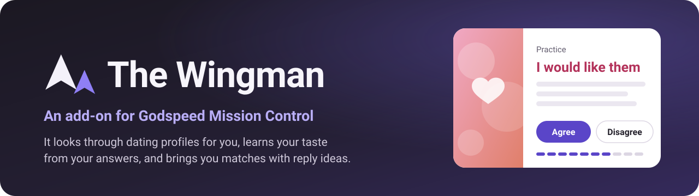
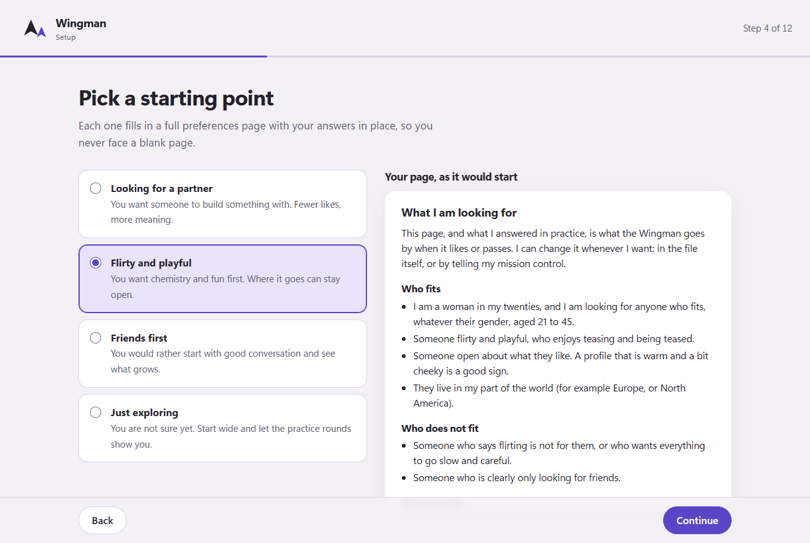
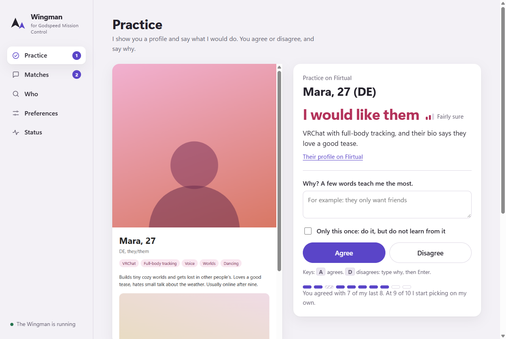
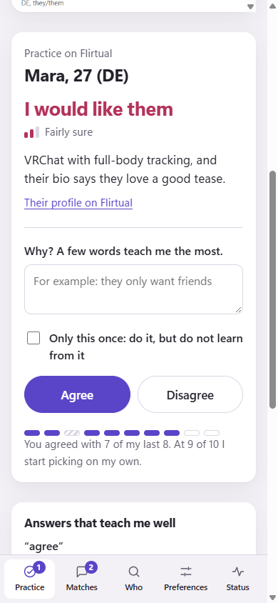

<p align="center"></p>

<p align="center">
  <a href="https://github.com/MichaelZelbel/godspeed-wingman/actions/workflows/test.yml"></a>
  <a href="LICENSE"></a>
  
  <a href="https://github.com/MichaelZelbel/godspeed-mission-control"></a>
</p>

# The Wingman

**Your mission control looks through dating profiles for you, learns your taste from your answers,
and brings you the matches with three reply ideas. You still do the talking.**

An add-on for [Godspeed Mission Control](https://github.com/MichaelZelbel/godspeed-mission-control),
the free personal AI you run yourself. The manual for Godspeed is the book
[*Teach It Once*](https://leanpub.com/teachitonce).

[](https://ko-fi.com/michaelc0de)

> **From your Wingman:** practice (you agreed with 7 of my last 8). Mara, 27 (DE): I would LIKE
> them, high sure. VRChat with full-body tracking, and their bio says they love being teased.
> Agree? Say "agree", or "disagree" and why.
>
> **You:** disagree, they only want friends
>
> **From your Wingman:** Noted: you passed on Mara because they only want friends. Next one in a moment.

## This is for some people, not most

The Wingman is for you if you date on a site like Flirtual, you like the people you meet there,
and you do not like spending an hour a day swiping. It does the swiping. It does not do the
dating: it never writes to anyone you did not pick, and every message it sends is one you chose
or dictated.

It needs Godspeed Mission Control first. If you do not have it yet, start with
[the install page](https://godspeedmissioncontrol.com/install) and Chapter 2 of the book.

## What it does

- **Every evening** it opens the profiles the site suggests, reads each one the way a friend who
  knows you would, and likes or passes at a person's pace (a random pause between profiles, never
  a burst).
- **It learns from you first.** Until you agree with 9 of its last 10 picks, every decision waits
  for your answer. Each answer, with your reason, becomes an example it reads before every later
  pick. Then it picks on its own, and you can review its choices any time.
- **Matches and messages** reach you with three reply ideas that play with a detail of their
  profile. "send 2" sends the second one. Your own words work too.
- **Watch list.** When a profile carries a name you put on it, the Wingman stops before liking or
  passing and asks you.
- **It remembers who was who.** "Who was Mara?" finds anyone it saw, by name, other usernames or a
  word from their bio, with a picture of their profile, for as long as you choose (six weeks by
  default), then it deletes them.

## What it never does

- Never sends a message you did not pick or dictate.
- Never writes to anyone outside the dating site.
- Never posts anything about your dating anywhere.
- Never puts the people it sees into your mission control's memory or into git. It can keep one
  list in your Godspeed notebook, "Wingman: likes and passes", with every like, pass and match,
  hidden from every assistant, but it is off unless you switch it on in the setup or with
  `"notebook_collection": true` in the settings. That list is not deleted after the days you chose;
  it stays until you delete it. "Who was that?" says whether someone is in it, with a link to their
  item. See [privacy](docs/privacy.md).
- Never works on a site whose terms forbid bots or automated use, unless you chose that after your
  mission control told you what those terms say (see [Sites](#sites)).

## Add it

**Windows** (PowerShell):

```powershell
irm https://raw.githubusercontent.com/MichaelZelbel/godspeed-wingman/main/install.ps1 | iex
```

**macOS or Linux:**

```bash
curl -fsSL https://raw.githubusercontent.com/MichaelZelbel/godspeed-wingman/main/install.sh | bash
```

**Or ask your mission control:** "Add the Wingman from github.com/MichaelZelbel/godspeed-wingman."
It follows [the steps for assistants](INSTALL-FOR-ASSISTANTS.md).

The installer finds your Godspeed folder and a Node.js 22 or newer (Godspeed brings one), copies
the Wingman in, starts it, and opens the setup wizard: in your browser on a computer with a screen,
in the terminal on a server. Run the same line again to update; your own files stay as they are.
More: [docs/getting-started.md](docs/getting-started.md).

## Your first ten minutes

The wizard walks you through it, one page at a time:

1. **Hello.** What the Wingman does and what it never does.
2. **Your site.** Flirtual is built in. Another site? See [Sites](#sites).
3. **You and who you are looking for.** A few quick choices.
4. **A starter, so you never face a blank page.** Pick the one closest to you (looking for a
   partner, flirty and playful, friends first, just exploring). It fills in a full preferences page
   in plain sentences, with your answers in place. Change any line.
5. **Clear yes and clear no.** Tick the green flags and deal-breakers that fit, add your own.
6. **How you write.** Your reply ideas will sound like you.
7. **When.** The time of the daily session (18:30 by default), your time zone, and how many days
   it remembers the people it saw (42 by default).
8. **Where it talks to you.** The Wingman's desk page, notifications on this computer, or Telegram
   when your assistant has a Telegram bot. Your mission control's chat sees every open question
   too, once the setup has connected it.
9. **Log in.** The Wingman opens its own browser; you log into the site once.
10. **Your existing AI connection.** The Wingman uses the model connection you chose in Godspeed.
    No separate subscription or login is needed.
11. **A last look.** Your preferences page as the Wingman will read it, and names to watch.
12. **First practice round.** Ten profiles. You agree or disagree, and say why.

<p align="center"></p>

## One AI connection

New installs use Godspeed's configured AI connection. Godspeed keeps the credentials and chooses
its provider, model and usage rules. The Wingman sends one isolated request with your preferences
and the profile text; it cannot give the model tools or access to your conversations.

Update Godspeed first if the setup says its shared model command is missing. The Wingman never
silently switches to an installed Claude Code or Codex program. Existing explicit separate model
choices remain unchanged; choose **Use Godspeed's existing AI connection** in setup to inherit it.
Provider subscriptions and API billing follow that provider's rules; sharing the connection does
not add an allowance. An AI failure pauses the Wingman and warns you, without skipping, liking or
passing a profile because of the error.

## Training

Training is a conversation, not a form. The Wingman shows a profile, says what it would do and why,
and you answer:

| You say | What it learns |
|---|---|
| `agree` | It was right. |
| `disagree, they only want friends` | Your reason. The most useful answer there is. |
| `like them, the bio is funny and we both build worlds` | A like with a reason. |
| `disagree, but only this time` | A one-off: the like or pass happens, the Wingman does not learn from it. |

A plain "no" works, but your reason is what it learns the most from. Say "practice" for another
round any time, "review" to go through what it decided on its own. More:
[docs/training.md](docs/training.md).

**Where you train:**

- **On this computer:** the Wingman's desk, a page that opens in your browser at
  `http://127.0.0.1:47860`. Big buttons, the profile picture, your progress to 9 of 10. A
  notification tells you when a question waits.
- **In your mission control's chat:** it sees the open question before every message, so a short
  "agree" lands in the right place.
- **On your phone, through Telegram:** when your mission control runs on a server with Telegram
  (Chapter 2 and Chapter 34 of the book), the questions arrive there.

<p align="center">
  
  
</p>

## Sites

**Flirtual** is built in, and it is the default for a reason: its terms (checked 10 October 2026)
say nothing against bots or AI. The Wingman behaves like a careful person there: one account, a
person's pace, no messages you did not choose.

**Want another site?** Tell your mission control: "Add <the site's name> to my Wingman."
Its coding helper follows the recipe that ships with the Wingman:

1. It reads the site's current terms first and quotes what they say about bots, automation and AI.
   **If the terms forbid it, it tells you so plainly**, with the risk: the site may suspend or close
   your account, and some sites notice automated use. Then you decide. Many big dating apps forbid
   it.
2. If you go ahead, it builds a small adapter for that site in your own mission control folder,
   checks it without liking or passing anyone, and switches it on. A site whose terms forbid
   automated use is switched on only by your own choice, recorded with the date
   (`godspeed-wingman site use <id> --accept-terms-risk`). A new site starts in practice, even when
   another site already runs on its own.

**What this repository ships is narrower.** It ships, and accepts, adapters only for sites whose
terms do not forbid automated or AI use. That is the author's choice about what to hand out with
the book and with Godspeed, not a limit on you: your own mission control can build an adapter for
any site you use, in your own folder, once it has told you what that site's rules say.

Details: [docs/adding-a-site.md](docs/adding-a-site.md).

**A service with no website, only a phone app?** The Wingman can set up an Android emulator on your
computer; you install the app there and log in, and the adapter drives the emulator. This is
experimental: it needs about 15 GB of disk and hardware virtualisation, and some apps refuse to run
in an emulator. [docs/android.md](docs/android.md).

## Everyday commands

You will mostly talk to your mission control in plain words. The commands underneath:

```
godspeed-wingman status            godspeed-wingman who "mara" --photo
godspeed-wingman train 10          godspeed-wingman review 5
godspeed-wingman prefs add "no smokers"     godspeed-wingman watch add "a name"
godspeed-wingman send 2 --to R4    godspeed-wingman pause | resume | run | check
godspeed-wingman desk              godspeed-wingman site list | new | check | use
godspeed-wingman help              godspeed-wingman uninstall
```

## What is where

- **Your words** live in your mission control, in `routines/wingman/`: `preferences.md`,
  `watch.md`, `settings.json`. Plain text you can edit by hand.
- **Everything about other people** (profiles, pictures, your practice answers, reply ideas, the
  log) lives in a private folder outside git (`~/.godspeed/wingman`; on a Linux server set up as
  root, `/var/lib/godspeed/wingman`), because git never forgets. It is deleted after the number of
  days you chose. The one exception is the notebook list of likes and passes: it is off unless you
  switch it on, and when it is on, it stays until you delete it.
- **Its browser** is its own browser profile, so it never touches your everyday logins. On a server
  it uses a browser on a computer at home, through the
  [Chrome Agent Bridge](https://github.com/MichaelZelbel/chrome-agent-bridge), 0.6.0 or newer.
  After an update of the bridge, restart every bridge instance on that computer
  ([docs/server.md](docs/server.md#the-bridge)).

More: [docs/privacy.md](docs/privacy.md), [docs/this-computer.md](docs/this-computer.md),
[docs/server.md](docs/server.md), [docs/architecture.md](docs/architecture.md),
[docs/faq.md](docs/faq.md).

## Honest limits

- Your computer has to be on at session time when the Wingman runs on it. On a server it runs
  around the clock.
- A lost login stops everything and tells you once a day. Only you can log in again.
- When errors stop a session (a crashed browser tab, a site that is down), the Wingman tries once
  more about an hour later. If that stops too, it tells you once that day, and your assistant
  finds the cause with `godspeed-wingman check`.
- Sites change. When a site changes its pages, the adapter may need a repair; `godspeed-wingman
  check` says so plainly.
- Without a paid plan some sites limit likes per day; the session simply ends there.
- The model you chose reads each profile next to your preferences, so both go to whichever
  service runs that model.

## Read more in the book

[*Teach It Once*](https://leanpub.com/teachitonce) is the manual for Godspeed Mission Control. The
chapters that matter most for the Wingman:

- **Chapter 41, Let Your Mission Control Be Your Wingman**: this add-on, step by step, and why I let
  it swipe for me.
- **Chapter 2, Set Up Godspeed Mission Control**: the install, and Telegram on your phone.
- **Chapter 9, Teach AI Your Writing Style**: why your reply ideas sound like you.
- **Chapter 12, Correct AI Without the Argument**: why practice answers with a reason work.
- **Chapter 20, Set Limits on What AI May Do**: what the Wingman may do alone.
- **Chapter 22, Check Where Your Private Information Goes**: why strangers' profiles stay out of git.
- **Chapter 34, Look After Your Server**: running it around the clock.
- **Chapter 40, Use Your Mission Control for Coding Projects**: how your coding helper adds a site.

## Contributing

New site adapters are welcome for services whose terms do not forbid automated or AI use. Read
[CONTRIBUTING.md](CONTRIBUTING.md) first; it says how to run the tests and what a site needs.
Security problems go through [SECURITY.md](SECURITY.md), never an open issue.

## License

MIT. Use it, change it, share it. Made by Michael Zelbel as part of
[Godspeed Mission Control](https://github.com/MichaelZelbel/godspeed-mission-control).
